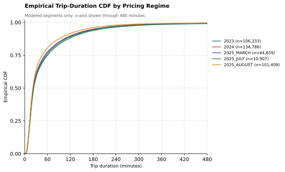

# EVIE Structural Demand Estimation and Pricing Optimization Methodology

## 1. EVIE Pricing and the Modeling Objective

EVIE prices usage through a nonlinear tariff. A user may face a monthly fee and monthly credit, and each trip is priced using a trip start fee, time-based charges, included miles, and extra-mile charges. For each plan $p$ in market $m$, let the tariff vector be

$$
\theta_{pm} = \left( f_{pm},\; r^{\min}_{pm},\; r^{\text{hour}}_{pm},\; r^{\text{day}}_{pm},\; X_{pm},\; r^{\text{mile}}_{pm},\; F_{pm},\; A_{pm} \right),
$$

where $f_{pm}$ is the trip start fee, $r^{\min}_{pm}$, $r^{\text{hour}}_{pm}$, and $r^{\text{day}}_{pm}$ are the per-minute, per-hour, and per-day rates, $X_{pm}$ is included miles, $r^{\text{mile}}_{pm}$ is the extra-mile rate, $F_{pm}$ is the monthly fee, and $A_{pm}$ is the monthly credit.

For a trip with duration $T$ minutes and distance $D$ miles, trip charges are

$$
c^{\text{trip}}(T, D; \theta_{pm}) = f_{pm} + \min\left\{ r^{\min}_{pm} T,\; r^{\text{hour}}_{pm} \lceil T/60 \rceil,\; r^{\text{day}}_{pm} \lceil T/1440 \rceil \right\} + r^{\text{mile}}_{pm} \max\{0, D - X_{pm}\}.
$$

For a monthly set of trips $B_i$, monthly user payment under plan $p$ is

$$
P_{ipm}(B_i; \theta_{pm}) = F_{pm} + \max\left\{ 0,\; \sum_{r \in B_i} c^{\text{trip}}(T_{ir}, D_{ir}; \theta_{pm}) - A_{pm} \right\}.
$$

The first objective is to estimate demand as a function of pricing. In this document, demand means the number of users choosing each monthly plan and trip-count product. Once the demand model has been estimated, it can be used to predict choices under counterfactual prices. Pricing can then be optimized for a chosen objective, such as revenue, utilization, access, or equity, subject to whatever business or operational constraints are relevant.

Let $\theta$ denote a candidate pricing policy and let $\widehat{\psi}$ denote estimated demand parameters. The general counterfactual pricing problem is

$$
\max_{\theta \in \Theta} \mathcal{W}(\theta; \widehat{\psi}) \quad \text{subject to} \quad h_r(\theta; \widehat{\psi}) \le 0, \quad r = 1, \dots, R,
$$

where $\mathcal{W}$ is the chosen objective and $h_r$ are operational, business, access, equity, utilization, or demand constraints. Revenue is one important objective, but the same demand model can be used with other objectives or constraints. The remainder of the document defines the demand model, explains how prices enter the model, and then describes prediction and pricing optimization.

## 2. Choice Setting, Markets, Products, and Shares

The demand model predicts monthly plan choice and monthly trip count. In each market, a user either takes no EVIE trips or chooses a plan and a trip-count category. The model does not separately predict the duration and distance of trips conditional on that plan and trip-count choice.

### 2.1 User Segments

Users are separated into three segments:

$$
g \in \{\text{Regular},\, \text{Access},\, \text{Student}\}.
$$

This segmentation is necessary because the paid-plan alternative differs by segment. For Regular users the paid plan is Everyday; for Access users it is Access; for Student users it is Student. Each segment also has Free Plan as an available alternative. Thus the plan set for segment $g$ can be written as

$$
\mathcal{P}_g = \{\text{Free Plan},\, \text{Paid}_g\},
$$

where

$$
\text{Paid}_{\text{Regular}} = \text{Everyday}, \qquad \text{Paid}_{\text{Access}} = \text{Access}, \qquad \text{Paid}_{\text{Student}} = \text{Student}.
$$

The demand model is estimated separately by segment so that each segment has its own product set, price variation, and substitution patterns.

### 2.2 Markets and Market Size

A market is the set of users facing the same monthly choice environment. In this setting, markets are defined as segment-months:

$$
m = (g, t),
$$

where $g$ is the user segment and $t$ is the calendar month. A segment-month market groups users who have the same segment-specific paid-plan alternative and the same calendar-month pricing environment. Market size $M_m$ is the number of users considered in-market for that segment-month. A user is in market in month $t$ if the user used EVIE in month $t$ or in the prior $K$ months. This recency rule defines the population at risk of choosing EVIE in that month. Other recency windows can be used, but changing the rule changes market size and therefore changes the outside option.

### 2.3 Products

An inside product is a plan crossed with a monthly trip-count category:

$$
j = (p, b), \qquad p \in \mathcal{P}_g, \quad b \in \mathcal{B}.
$$

The trip-count categories are intervals,

$$
\mathcal{B} = \left\{ [\ell_1, u_1], [\ell_2, u_2], \dots, [\ell_B, \infty) \right\},
$$

with $\ell_1 = 1$, $\ell_{r+1} = u_r + 1$, and an open-ended final bin. A simple example is

$$
\mathcal{B} = \{[1,1], [2,2], [3,3], [4,4], [5,8], [9,12], [13,20], [21,\infty)\}.
$$

The exact binning is a product-definition choice. Finer bins preserve more detail about usage intensity but can create sparse products. Coarser bins increase support but combine users with more heterogeneous monthly usage. A reasonable binning rule should be ordered, contiguous, non-overlapping, and sufficiently supported in the historical data.

Let $a_{im}$ denote the alternative chosen by user $i$ in market $m$:

$$
a_{im} \in \{0\} \cup \mathcal{J}_m, \qquad \mathcal{J}_m = \mathcal{P}_g \times \mathcal{B}.
$$

If the user takes no EVIE trips in the month, $a_{im} = 0$. If the user takes a positive number of trips, $a_{im} = j$ for the product $j = (p, b)$ that records the plan used and the trip-count bin containing that monthly trip count.

This choice definition captures plan choice and monthly usage intensity. It does not directly model trip duration or trip distance conditional on the chosen plan and trip-count category. Duration and distance enter through the empirical expected-cost construction described below.

### 2.4 Outside Option and Observed Demand

The outside option is no monthly EVIE use by an in-market user. It is denoted by $j = 0$. Observed inside-product counts and shares are

$$
q_{jm} = \#\{i \in m : a_{im} = j\}, \qquad s_{jm} = \frac{q_{jm}}{M_m}.
$$

Observed outside demand is

$$
q_{0m} = M_m - \sum_{j \in \mathcal{J}_m} q_{jm}, \qquad s_{0m} = \frac{q_{0m}}{M_m}.
$$

These observed counts and shares are the empirical demand objects used in estimation.

## 3. Perturbed-Utility Demand Model

### 3.1 General Perturbed-Utility Problem

For each inside product $j$ in market $m$, let $V_{jm}$ be deterministic mean utility. Aggregate product shares are modeled as the solution to

$$
\max_{\{s_{\ell m}\}_{\ell \in \{0\} \cup \mathcal{J}_m}} \left\{ \sum_{j \in \mathcal{J}_m} s_{jm} V_{jm} - \Omega_m(s_m) \right\}
$$

subject to

$$
s_{\ell m} \ge 0, \qquad \sum_{\ell \in \{0\} \cup \mathcal{J}_m} s_{\ell m} = 1.
$$

The perturbation $\Omega_m(\cdot)$ is a convex cost of concentrating all demand on one alternative. It smooths the choice probabilities and defines the substitution structure across products.

### 3.2 Shannon Entropy Perturbation

The model uses the Shannon entropy perturbation:

$$
\Omega_m(s_m) = \tau \sum_{\ell \in \{0\} \cup \mathcal{J}_m} s_{\ell m} \log(s_{\ell m}).
$$

The scale parameter $\tau > 0$ is not separately identified from the utility coefficients, so we normalize $\tau = 1$.

The market-share problem is therefore

$$
\max_{s_m} \left\{ \sum_{j \in \mathcal{J}_m} s_{jm} V_{jm} - \sum_{\ell \in \{0\} \cup \mathcal{J}_m} s_{\ell m} \log(s_{\ell m}) \right\}.
$$

The Lagrangian is

$$
\mathcal{L} = \sum_{j \in \mathcal{J}_m} s_{jm} V_{jm} - \sum_{\ell \in \{0\} \cup \mathcal{J}_m} s_{\ell m} \log(s_{\ell m}) + \lambda_m \left( 1 - \sum_{\ell \in \{0\} \cup \mathcal{J}_m} s_{\ell m} \right).
$$

For inside product $j$,

$$
V_{jm} - (\log(s_{jm}) + 1) - \lambda_m = 0.
$$

For the outside option, deterministic utility is normalized to zero, $V_{0m} = 0$, so

$$
-(\log(s_{0m}) + 1) - \lambda_m = 0.
$$

Subtracting the outside-option condition from the inside-product condition gives

$$
\log(s_{jm}) - \log(s_{0m}) = V_{jm}.
$$

Thus

$$
s_{jm} = s_{0m} \exp(V_{jm})
$$

and the adding-up condition implies

$$
s_{0m} = \frac{1}{1 + \sum_{k \in \mathcal{J}_m} \exp(V_{km})}.
$$

Inside-product shares are therefore

$$
s_{jm} = \frac{\exp(V_{jm})}{1 + \sum_{k \in \mathcal{J}_m} \exp(V_{km})}.
$$

The Shannon entropy perturbed-utility model is therefore equivalent to a multinomial logit demand system with an outside option.

## 4. Mean-Utility Inversion and Estimation

The previous section gives the logit share equation. Dividing an inside-product share by the outside share gives

$$
\frac{s_{jm}}{s_{0m}} = \exp(V_{jm}).
$$

Taking logs gives

$$
\log(s_{jm}) - \log(s_{0m}) = V_{jm}.
$$

This motivates the mean-utility index

$$
\delta_{jm} \equiv \log(s_{jm}) - \log(s_{0m}).
$$

Under the entropy/logit model, $\delta_{jm} = V_{jm}$. This is the key share-inversion result: observed market shares can be transformed into a product-market mean utility index. The demand parameters can then be estimated with a regression rather than with individual-level maximum likelihood.

In data, shares are constructed from observed counts:

$$
s_{jm} = \frac{q_{jm}}{M_m}, \qquad s_{0m} = \frac{q_{0m}}{M_m}.
$$

When counts are positive, the market-size denominator cancels:

$$
\delta_{jm} = \log\left(\frac{q_{jm}}{M_m}\right) - \log\left(\frac{q_{0m}}{M_m}\right) = \log(q_{jm}) - \log(q_{0m}).
$$

When a product has zero observed demand, the log is undefined. The empirical inversion therefore uses a small positive pseudo-count $\varepsilon$:

$$
\widehat{\delta}_{jm} = \log(q_{jm} + \varepsilon) - \log(q_{0m} + \varepsilon).
$$

This smoothing is on the count scale and is used only to keep the inversion finite.

The deterministic utility specification is

$$
V_{jm} = \beta_0 + \alpha C_{jm}(\theta) + x_{jm}' \beta + \xi_{jm}.
$$

Substituting this utility specification into the share-inverted mean utility gives the estimating equation

$$
\widehat{\delta}_{jm} = \beta_0 + \alpha C_{jm}(\theta) + x_{jm}' \beta + \xi_{jm}.
$$

In this regression, the dependent variable $\widehat{\delta}_{jm}$ is computed from observed product counts and outside-option counts. The observed regressors are expected product cost $C_{jm}(\theta)$ and the non-price controls $x_{jm}$. The parameters estimated by the regression are the inside-product intercept $\beta_0$, the price coefficient $\alpha$, and the non-price utility coefficients $\beta$. The residual $\xi_{jm}$ represents unobserved product-market demand shocks.

A negative $\alpha$ means higher expected user payment lowers mean utility. The controls $x_{jm}$ may include trip-count-bin fixed effects, plan fixed effects, month-of-year fixed effects, or other predetermined shifters. The outside option's deterministic utility is normalized to zero, so the intercept and fixed effects are interpreted relative to no monthly EVIE use. If a fixed effect is included, one category is omitted as the reference category.

The equation is estimated by weighted least squares, using market size as the regression weight and clustering standard errors by calendar month. Weighting by market size gives larger markets more influence because their observed shares are measured with less sampling noise.

The construction of $C_{jm}(\theta)$ is a separate empirical-pricing step. It is the main complication created by EVIE's nonlinear tariff structure and is described next.

## 5. Expected Product Cost and the Empirical Basket Kernel

The regression needs one price variable for each product-market pair: $C_{jm}(\theta)$. This is straightforward in a model where each product has one posted price. It is less straightforward here because a product is defined only by plan and monthly trip-count bin,

$$
j = (p, b),
$$

while the actual amount paid also depends on trip durations, trip distances, the minimum of the minute/hour/day charges, included miles, extra-mile fees, monthly fees, and monthly credits. Two users in the same plan and trip-count bin can therefore have different monthly payments.

The price variable used in utility is expected monthly user payment for the product:

$$
C_{jm}(\theta) = \mathbb{E}\left[ P_{ipm}(B_i; \theta_{pm}) \mid i \text{ belongs to the usage distribution for } (j, m) \right].
$$

Thus $C_{jm}(\theta)$ summarizes the expected out-of-pocket cost of choosing plan $p$ and trip-count bin $b$ in market $m$ under tariff $\theta$.

A *basket* is one positive-use user-month:

$$
B_i = \left( N_i,\; \{(T_{ir}, D_{ir})\}_{r=1}^{N_i} \right),
$$

where $N_i$ is the number of trips in that month and $(T_{ir}, D_{ir})$ are the duration and distance of trip $r$. A basket is not a single trip. It is the complete monthly object needed to evaluate monthly credits, included miles, and nonlinear trip charges.

Let $\mathcal{K}_{jm}$ denote the empirical source set of baskets assigned to product $j = (p, b)$ in market $m$. Expected product cost is computed by repricing every source basket under the candidate tariff:

$$
C_{jm}(\theta) = \frac{1}{|\mathcal{K}_{jm}|} \sum_{i \in \mathcal{K}_{jm}} P_{ipm}(B_i; \theta_{pm}).
$$

The kernel should be interpreted as the empirical distribution of complete baskets for a product. It is not an independent draw of a trip count followed by independent draws of trip durations and distances. Preserving complete baskets matters because monthly costs are nonlinear in the full set of trips.

The source set $\mathcal{K}_{jm}$ is defined in two layers. First, because the trip-count bin is part of the product definition, the kernel must use baskets whose monthly trip count belongs to the same bin:

$$
N_i \in b.
$$

For example, if $b = [9, 12]$, then the source baskets must have 9, 10, 11, or 12 trips. This condition should not be relaxed, because otherwise the expected cost of a high-trip product could be computed from low-trip baskets.

Second, the kernel may condition on additional variables:

$$
Z_i = \{\text{segment},\, \text{plan group},\, \text{trip-count bin},\, \text{month-of-year}\}.
$$

Trip-count bin is always retained. Segment, plan group, and month-of-year are modeling choices. Conditioning on them can make source baskets more similar to the target product, but it can also create sparse source sets. Less conditioning increases support but pools more heterogeneous baskets.

A minimum-support rule formalizes this tradeoff. If the target source set has fewer than a chosen number of baskets, the source set can be broadened by relaxing selected conditioning variables in a prespecified order while retaining the trip-count bin. This produces an expected cost that is still tied to the product's usage range but avoids relying on extremely small empirical samples.

For validation and counterfactual prediction, expected costs should be built from training-period baskets. This avoids using future trip realizations to construct expected prices for test or counterfactual markets.

## 6. Behavioral Scope: Product Choice Versus Trip Type

The model predicts monthly plan choice and monthly trip-count bin:

$$
a_{im} \in \{0\} \cup \mathcal{J}_m, \qquad \mathcal{J}_m = \mathcal{P}_g \times \mathcal{B}.
$$

It does not separately model the user's choice of trip duration or trip distance conditional on that product. These two trip characteristics matter because EVIE charges depend directly on minutes and miles.

This distinction is important. Different products can have different empirical basket distributions. For example, a high-count product can have a different distribution of trip durations and distances than a one-trip product. The expected-cost kernel captures those product-specific distributions when repricing baskets. Therefore, if a price change moves demand from one product to another, aggregate expected trips, minutes, miles, and revenue can change because the product mix changes.

However, conditional on a product's basket distribution, the counterfactual assumption is:

$$
\left( N_i, \{(T_{ir}, D_{ir})\}_{r=1}^{N_i} \right) \text{ is held fixed while } \theta \text{ changes.}
$$

In words, prices can change the probability that users choose a product, but the model does not predict that users choosing the same plan and trip-count bin will change the duration or distance distribution of those trips because of the price change.

Figure 1 shows empirical trip-duration CDFs by posted pricing regime for the modeled segments. The distributions are broadly similar in shape, but they are not identical. In particular, the 2025 August regime has a somewhat higher CDF at many durations, meaning observed trips in that regime are modestly shorter than in some earlier regimes. This supports a limited version of the fixed-duration-distribution assumption: the duration distribution does not appear to change radically across posted pricing regimes, but there is some movement. The assumption should therefore be treated as an approximation. If a future pricing policy is expected to substantially change trip duration or distance conditional on plan and trip count, the counterfactual predictions should be interpreted cautiously.

*Figure 1: Empirical trip-duration CDFs by pricing regime. The figure uses modeled segments only and displays the distribution through 480 minutes for readability. Regenerate it after a data refresh with `python docs/make_duration_cdf.py`.*

## 7. Prediction and Validation

Prediction requires estimating the demand model first. For a given training set, the procedure is:

1. define markets, market sizes, products, and observed product counts;
2. construct training-period empirical kernels;
3. compute expected product costs $C_{jm}(\theta)$ under observed pricing;
4. invert observed shares to obtain $\widehat{\delta}_{jm}$;
5. estimate $\widehat{\beta}_0$, $\widehat{\alpha}$, and $\widehat{\beta}$ from the share-inversion regression;
6. form the fitted utility index $\widehat{V}_{jm}(\theta) = \widehat{\beta}_0 + \widehat{\alpha} C_{jm}(\theta) + x_{jm}' \widehat{\beta}$;
7. use the fitted utility index to predict shares in training, validation, or counterfactual markets.

Given estimated parameters and a candidate tariff $\theta$, predicted utility is

$$
\widehat{V}_{jm}(\theta) = \widehat{\beta}_0 + \widehat{\alpha} C_{jm}(\theta) + x_{jm}' \widehat{\beta}.
$$

Predicted shares are

$$
\widehat{s}_{jm}(\theta) = \frac{\exp(\widehat{V}_{jm}(\theta))}{1 + \sum_{k \in \mathcal{J}_m} \exp(\widehat{V}_{km}(\theta))}.
$$

Predicted product demand is

$$
\widehat{D}_{jm}(\theta) = M_m \widehat{s}_{jm}(\theta).
$$

Monthly user-payment revenue is

$$
\widehat{R}_m(\theta) = \sum_{j \in \mathcal{J}_m} \widehat{D}_{jm}(\theta) C_{jm}(\theta).
$$

Predicted monthly trips are

$$
\widehat{T}_m(\theta) = \sum_{j \in \mathcal{J}_m} \widehat{D}_{jm}(\theta) \overline{N}_{jm},
$$

where $\overline{N}_{jm}$ is the mean trip count in the kernel source for product $j$ and market $m$.

Validation compares observed outcomes to predicted outcomes in held-out markets. Useful validation outcomes include user-payment revenue, Free Plan trips, paid-plan trips, total trips, and product-level demand.

## 8. Pricing Optimization Method

After estimating demand, pricing can be optimized by repeatedly evaluating candidate tariff vectors through the structural model. The revenue optimization problem can be written as

$$
\widehat{\theta}^R = \arg\max_{\theta \in \Theta} \sum_{m \in \mathcal{M}^*} \sum_{j \in \mathcal{J}_m} M_m \widehat{s}_{jm}(\theta; \widehat{\psi}) C_{jm}(\theta).
$$

An example trip-volume constraint is

$$
\sum_{m \in \mathcal{M}^*} \widehat{T}_m(\theta) \ge (1 - \eta) \sum_{m \in \mathcal{M}^*} \widehat{T}_m(\theta^0),
$$

where $\eta$ is the maximum allowed trip-volume drop and $\theta^0$ is baseline pricing. If desired, the same constraint can be imposed separately in every market:

$$
\widehat{T}_m(\theta) \ge (1 - \eta) \widehat{T}_m(\theta^0) \qquad \forall m \in \mathcal{M}^*.
$$

The optimization problem is nonlinear and may be nonconvex. It also includes tariff components such as ceilings, minima, max operators, monthly credits, and discrete support rules for empirical kernels. These features make a simple gradient-only approach unattractive as the primary search method. The practical procedure is therefore derivative-free direct search with optional local polishing:

1. choose the tariff parameters allowed to vary and their lower and upper bounds;
2. generate candidate tariff vectors using Latin hypercube sampling;
3. evaluate each candidate by repricing baskets, predicting product shares, computing revenue, and checking constraints;
4. repeat the global sampling step with multiple random seeds;
5. perform local coordinate refinement around the best candidates;
6. optionally use a constrained local solver, such as SLSQP, to polish the best solution; and
7. report the best feasible candidate found.

Latin hypercube sampling is a stratified random design. For each free pricing dimension, the allowed interval is divided into equally sized probability strata, and candidate points are drawn so that each stratum is represented. Compared with purely independent random sampling, this gives better coverage of each parameter's range for a fixed evaluation budget. Multiple random seeds reduce dependence on any one sampled design. Local coordinate refinement then searches around promising candidates by moving one parameter direction at a time.

This approach is used because it is flexible: it can handle arbitrary subsets of pricing parameters, parameter bounds, fixed overrides, proportional time-rate restrictions, and trip-volume constraints. It is also transparent: every candidate tariff is evaluated by the same structural demand model. The tradeoff is that the procedure does not certify a global optimum. It reports the best feasible solution found within the chosen bounds, seeds, and evaluation budget.

## 9. Limitations and Appropriate Interpretation

The model is intended for structured pricing analysis. Important limitations are:

- **Trip-type invariance.** The model predicts plan and trip-count choice, not within-product changes in trip duration or trip distance.
- **Logit substitution.** The Shannon entropy model implies a multinomial-logit substitution structure. Product definitions and fixed effects improve fit but do not fully eliminate the independence structure of logit demand.
- **Price endogeneity.** The current estimation approach does not instrument for price. The price coefficient should be interpreted as a practical structural approximation, not as a fully causal IV estimate.
- **Historical support.** Expected costs rely on historical baskets. Counterfactuals far outside observed pricing or usage patterns are less reliable.
- **Sparse products.** Detailed product-level predictions can be noisy when the relevant kernel source has few baskets.
- **Optimization is search based.** The optimizer returns the best feasible candidate found, not a proof of global optimality.

The model is best used to compare plausible pricing policies, understand directional revenue and usage tradeoffs, and identify candidate tariffs for further operational review. I would use the model cautiously and for optimization, use tight bounds on parameters.
